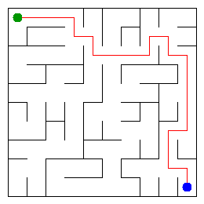

# Assignment 3. Maze Escape

Student ID: 250986
Name: Tilekkali Nurtore
Group: SE-2540
Maze size (rows x columns): 10 x 10

## Program output

The 13 lines printed by `java -cp out Main` on my data:

```text
Broken: 99
Kept: 81
Last broken wall: 133
MST cost: 33122
Heaviest broken wall: 770
Path length: 22
DFS visited: 33
Dead ends: 32
Zones: 8
Largest zone: 19
Is DAG: 0
Flow stages: 8
Fastest route cost: 20
```

## My maze



## Questions

### Mission 0. What do find and union do, and what makes them fast in your code?

The `find` method finds which group an element belongs to by returning its root. The `union` method joins two groups if they are different. Union by size and path compression make these operations fast.

### Mission 1. Why is Broken always R*C - 1, and Kept always (R-1)*(C-1)?

A maze with R rows and C columns has R*C cells. To connect all cells without cycles, exactly R*C - 1 walls must be broken. The total number of walls is R*(C-1) + C*(R-1), so the number of walls kept is (R-1)*(C-1).

### Mission 2. My MST cost from Kruskal and from Prim, and why they are equal:

The MST cost from Kruskal is 33122. Prim should return the same cost because both algorithms find a minimum spanning tree of the same graph. They may choose different walls, but the minimum total cost is the same.

### Mission 3. Why is there exactly one path between two cells? How did you avoid a stack overflow on a huge maze?

The maze is connected, and it has no cycles because each broken wall joins two previously separate groups. This makes it a tree, so there is exactly one path between any two cells. I used an explicit stack for DFS instead of recursive calls, which avoids a stack overflow on large mazes.

### Mission 4. Why does the second pass of Kosaraju go on the reversed graph? Why do the slides have no cycle exactly when Zones equals the number of cells?

The reversed graph lets the second DFS find strongly connected components using the finishing order from the first pass. If every cell is its own zone, there are no cycles involving different cells. If any cycle exists, at least two cells belong to the same strongly connected component, so the number of zones is smaller than the number of cells.

### Mission 5. Why is it enough to go through the zones in the order of their numbers? What does this pass cost?

The zones are numbered in topological order, so every slide between different zones goes from a lower number to a higher number. This lets the algorithm calculate the longest chain and the cheapest route in one pass without needing a priority queue. The route calculation takes O(m + z²) time and O(z²) space, where m is the number of slides and z is the number of zones.

## AI use

I used ChatGPT to understand the assignment requirements, explain the algorithms and review parts of the Java code. I used the provided `java tools/Check.java` command to check the implementation.

## Timing (Mission 7)

Average running times in milliseconds from five runs of `java -cp out Bench`:

| Maze size | Kruskal (ms) | Prim (ms) |
|:---|---:|---:|
| 100 x 100 | 14 | 12 |
| 300 x 300 | 77 | 87 |
| 1000 x 1000 | 1554 | 2478 |

The running time increases as the maze gets larger. Kruskal takes 14 ms for a 100 x 100 maze and 1554 ms for a 1000 x 1000 maze. Prim takes 2478 ms on the largest maze, although it is slightly faster on the smallest one. The measured times can vary between runs.

## Complexity

Here, n is the number of cells, m is the number of walls or slides, and z is the number of zones.

| Algorithm | Time complexity | Space complexity | Assumptions |
|:---|:---|:---|:---|
| DSU `find` and `union` | Amortized O(α(n)) per operation | O(n) | Union by size and path compression |
| Kruskal | O(m log m) | O(n + m) | Walls are sorted by cost; DSU is used |
| Prim | O(m log n) | O(n + m) | Adjacency lists and a priority queue are used |
| DFS | O(n) | O(n) | The maze is a tree; DFS uses an explicit stack |
| Kosaraju | O(n + m) | O(n + m) | Two iterative DFS passes are used |
| Route in the zone graph | O(m + z²) | O(z²) | A cost matrix is used for zone pairs |

